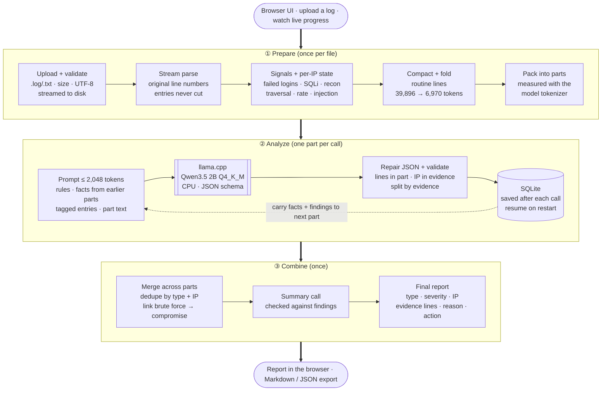

# Local AI Security Log Analyzer

A web app that finds possible attacks in server logs using a **local** language model
(Qwen3.5 2B, Q4_K_M GGUF, served by llama.cpp on CPU). The log is larger than the model's
2,048-token window, so the app compacts it, splits it into token-measured parts, analyzes
them one at a time while carrying facts forward, and merges everything into one report
with evidence line numbers.

Runs fully offline after setup. No cloud AI is called at runtime.

---

## Quick start

Requirements: Docker with Compose (on macOS, [OrbStack](https://orbstack.dev) or Docker Desktop), ~2 GB free disk.

```bash
./scripts/download_model.sh      # one-time: downloads the 1.28 GB GGUF and verifies its SHA-256
docker compose up -d             # starts llama.cpp (model) + the API/UI
```

Open **http://localhost:8000**, drop a `.log` / `.txt` file, press **Start analysis**.

The first start takes ~10 s while the model loads. After setup, nothing needs network access.

Run the tests (no model needed):

```bash
cd backend && python3 -m venv .venv && .venv/bin/pip install -r requirements-dev.txt && .venv/bin/pytest -q
```

Local development without Docker: run `llama-server` yourself (same flags as in
`docker-compose.yml`), then `LLM_URL=http://localhost:8080 .venv/bin/uvicorn app.main:app`.

---

## Resource envelope (4 GB RAM, 2 vCPU, no GPU)

| Service | Image | RAM limit | Measured | CPU |
|---|---|---|---|---|
| `llm` | `ghcr.io/ggml-org/llama.cpp:server-b12169` (pinned) | 3,072 MB | ~1.81 GB (weights resident, prompt RAM cache off) | cores 0–1, 2 threads |
| `api` | Python 3.12 slim, FastAPI, SQLite | 1,024 MB | ~65–95 MB | cores 0–1 (shared) |
| **Total** | | **4,096 MB** (swap disabled) | **~1.86 GB, flat during runs** | **2 vCPU** |

- `--ctx-size 2048 --parallel 1`: one request at a time, one KV cache, exact 2,048-token limit.
- `--cache-ram 0 --ctx-checkpoints 0`: llama.cpp's host-RAM prompt cache defaults to 8 GiB and grew
  the model process to 2.93 GB during one run; disabled, memory stays flat (see `docs/benchmarks.md`).
- The API runs a single background worker: one model call at a time, never concurrent.
- Uploads are streamed to disk and parsed line by line; the full log is never held in memory.
  The only derived copy is the compact text of each part, stored once in SQLite (needed for resume).
- The dashboard shows live RAM (model + app, read via a shared PID namespace) and per-call timing.

## Model

| | |
|---|---|
| Model | Qwen3.5 2B (instruct), text only |
| File | `Qwen3.5-2B-Q4_K_M.gguf` from `unsloth/Qwen3.5-2B-GGUF`, 1.28 GB, SHA-256 `aaf42c8b…9223` |
| Runtime | llama.cpp `llama-server` b12169, CPU, OpenAI-compatible API |
| Decoding | temperature 0 (0.2 on retry), **thinking disabled**, **JSON-schema grammar** (output is always valid JSON in shape) |
| Speed (2 cores, Apple Silicon) | ~67 tok/s prompt, ~20 tok/s generation, ~20–30 s per part |

Switch model or prompt version with env vars: `MODEL_FILE=… MODEL_NAME=… PROMPT_VERSION=v2 docker compose up -d`.

---

## How it works



**Deployment:** two containers on the same 2 CPU cores — `api` (FastAPI, SQLite, static UI;
1 GB limit) and `llm` (llama.cpp server; 3 GB limit) — 4 GB total, no swap. Only the API talks to
the model (`/tokenize`, `/apply-template`, `/v1/chat/completions`); the UI gets progress over
Server-Sent Events.

### 1. Parsing and compaction
- Formats: JSON lines, Apache/Nginx combined/common, free text. Continuation lines (stack
  traces) stay attached to their entry, and an entry keeps its **original line range** (`L12-15`).
- Each entry becomes one compact line: `L196 10:10:10 cultive8 workspace/gateway ip=203.0.113.44
  POST /api/v1/auth/login 200 user=workspace.admin ua=python-requests/2.32.3 auth_result=success [auth_success,success_after_12_failures]`.
  Fields with no security value (host, request id, browser UA, byte counts) are dropped;
  URLs are decoded (double encoding included); values are clipped.
- Runs of **routine** entries (no signal, status < 400, GET/HEAD, IP not suspicious) are folded
  into one line that keeps the range: `L36-40 ~ 5 routine entries (GET 200/304, 5 IPs)`.

Sample log: **39,896 tokens raw → 6,970 tokens compact** (−83%), 160 of 258 entries folded.

### 2. Token budget (per call, counted with the model's own tokenizer)

| Part of the prompt | Tokens |
|---|---|
| System rules + part header (measured via `/apply-template` + `/tokenize`) | 567 |
| Tagged-entry list + carried facts from earlier parts | ≤ 300 |
| Log text of the part | ≤ 713 (2048 − 420 − 300 − 48 − 567) |
| Reserved for the reply (`max_tokens`) | 420 |
| Safety margin | 48 |
| **Total** | **≤ 2,048** |

Before each call the exact prompt is re-counted; if it would leave less room than the reply
needs, carried facts are trimmed (least important first). The largest real call on the sample
log used 1,790 of 2,048 tokens (prompt 1,545 max).

### 3. Splitting
Entries are packed greedily into parts using their measured token counts. A part never
splits an entry. Every part is a contiguous line range, so every line of the file belongs to
exactly one part.

### 4. Linking across parts
- **Code-side state** (one forward pass): per-IP counters for failed logins, success-after-failures,
  scanner paths, SQLi/traversal patterns, 403/429 counts, request rate. At the start of part N
  only what was seen in parts 1..N−1 is known — the same view a human reading top-down has.
- **Carried facts** in the prompt: e.g. `- 203.0.113.44: 11 failed logins (L5,L13..L153) user=workspace.admin; already reported: brute_force High`.
  This is how the model, reading part 8, recognises that the login success at L196 follows
  failures at L5–L189 and reports `credential_compromise`.
- **Merge**: findings are grouped by (attack type, IP); line evidence is unioned; severity is
  the max; repeated reports from several parts become one finding that lists the parts.
  A brute-force finding whose IP later logged in successfully is linked to a Critical
  `credential_compromise` finding with the failure → success → admin/export evidence.
  Findings from the same IP are cross-referenced and shown as one attack chain.

### 5. Validation (keeps the model honest)
- Cited line numbers must exist in the part the model saw (others are rejected).
- The IP must appear in the cited entries; otherwise the evidence's IP is used, and an IP
  that appears nowhere in the evidence is rejected as hallucinated.
- At least one cited entry must carry an attack indicator — operational errors alone
  (DB timeouts, deploy 503s, exceptions) are never reported as attacks.
- Findings are split by the defining tag of each cited entry (scanner path → `scanning`, traversal
  pattern → `path_traversal`, failed login → `brute_force`, success after failures →
  `credential_compromise`); the model's label is kept in `relabeled_from`. "Critical" is reserved for
  compromise / data theft.
- Whole-file check at merge: `brute_force` needs ≥ 3 failed logins from that IP in the file.
- The executive summary is checked clause by clause: an attack named next to an IP must be one of
  that IP's findings. Otherwise it is regenerated once, then replaced by a deterministic summary
  (labelled in the UI).
- Rejected findings are kept in the report's run details for transparency.
- Code signals the model did not confirm are listed separately as "not confirmed", never as findings.

### 6. Reliability
| Failure | Handling |
|---|---|
| Invalid upload (wrong type, empty, binary, not UTF-8, > 20 MB) | Rejected with a plain-language reason and a hint |
| Model not ready / unreachable | Waits with backoff (up to 5 min), then retries |
| Timeout (240 s per call) | Retry with backoff, up to 3 attempts per part |
| Broken / truncated JSON | Strip fences → balance brackets → salvage complete objects → retry |
| Context overflow | Carried facts halved and the call retried |
| Part still failing | Marked failed; other parts continue; report notes it; "Retry failed parts" button |
| API restart / crash | Completed parts are in SQLite; the job resumes from the next part automatically |
| User cancel | Stops between parts; "Resume" continues from where it stopped |

### 7. Treating logs as data
The log is wrapped in `<log>…</log>` and the system prompt states it is untrusted data.
Entries that try to instruct an AI are flagged by a pattern (`[prompt_injection_text]`) and
reported as a `prompt_injection` finding. Nothing from a log is executed, and the UI renders
all log text with `textContent` (no HTML injection).

---

## API

| Method | Path | |
|---|---|---|
| POST | `/api/jobs` | upload (multipart `file`) |
| POST | `/api/jobs/{id}/start` · `/retry` · `/cancel` | control |
| GET | `/api/jobs/{id}` · `/stream` (SSE) | status, progress, report |
| GET | `/api/jobs/{id}/lines?n=1,2` | original lines (evidence viewer) |
| GET | `/api/jobs/{id}/report.md` · `/report.json` | export |
| GET | `/api/system` | model status, RAM, timing |

## Project layout

```
backend/app/
  parser.py      streaming parse + compact form       signals.py   patterns + per-IP state
  planner.py     token budget + packing into parts    llm.py       llama.cpp client
  worker.py      queue, retries, resume, finalize     analyzer.py  carry, validation, merge
  jsonrepair.py  tolerant JSON parsing                schemas.py   JSON schema + normalisation
  replay.py      re-validate stored replies (no model calls): python -m app.replay <job_id>
  prompts/       versioned prompts (system_vN, chunk_vN, summary_system_vN)
frontend/        index.html, styles.css, app.js (no build step)
docs/            prompt-changelog.md, benchmarks.md
```

## Accuracy on the sample log

Five full runs, final code: all 8 expected cases found in 1 run, 7 of 8 in 4 runs, **no false
positives** in any run, and the brute force → compromise chain linked every time. The one miss is a
single 403 on an admin URL (L102); it is listed under "Signals the model did not confirm".
Details: [docs/prompt-changelog.md](docs/prompt-changelog.md).

## Known limits
- **Speed**: ~20–30 s per part on 2 CPU cores; the sample log (11 parts + summary) takes about 5 minutes.
- **Small-model judgment**: a 2B model misses things a larger model would catch and sometimes
  mislabels types. Output varies between runs on borderline entries (e.g. a single 403 on an admin URL);
  such lines then appear under "Signals the model did not confirm". The tagged-entry list and validation compensate, but recall depends on the
  pattern signals for unusual attack types.
- **Signals are generic patterns** (SQLi, traversal, scanner paths, auth failures, rates). Attacks
  that leave no such trace in a single line (e.g. slow low-volume abuse) depend on the model alone.
- **Rate detection** uses timestamps within the file; logs without timestamps lose it.
- Timestamps are compared within the file only; no timezone normalisation.
- Single-user tool: no authentication on the web UI (bind to localhost or put it behind a proxy).
- Folding routine entries reduces calls a lot, but a routine-looking request (GET 200 from an
  unflagged IP) is not shown to the model individually. Set `COLLAPSE_BENIGN=false` to send every entry.
